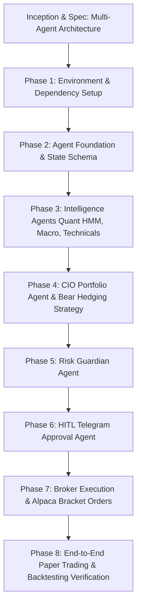

# Multi-Agent Trading System: Workflow & Implementation Plan

## Workflow Phases

## Work Breakdown Structure (Units)

### Unit 1: Foundation & Dependencies
- Set up Python virtual environment with required packages: `alpaca-py`, `python-telegram-bot`, `hmmlearn`, `pydantic`, `pandas`, `ta`, `pytest`.
- Update configuration schema (`config/settings.yaml`) to include Telegram bot credentials and bear market parameters.

### Unit 2: Agent Communication & Shared State
- Implement Typed State schema (`TradingState`, `AgentSignal`, `RiskDecision`, `TradeProposal`).
- Implement asynchronous agent orchestrator loop.

### Unit 3: Intelligence Agents
- **Quant Regime Agent**: Port and test Gaussian HMM forward algorithm and BIC selection.
- **Technical Analysis Agent**: Multi-indicator trend, S/R, and volatility filters.
- **Macro/News Agent**: Macro sentiment and event risk calendar checker.

### Unit 4: CIO Strategy & Bear Hedging
- Multi-signal consensus logic.
- Long / Cash preservation / Inverse hedging / Short allocation rules.

### Unit 5: Risk Guardian (Veto Layer)
- Complete position sizing (1% rule), exposure checks, daily/weekly circuit breakers.

### Unit 6: Telegram HITL Bot
- Interactive inline button messages (`Approve`, `Reject`, `Scale 50%`).
- Async callback handler with configurable expiration timeout.

### Unit 7: Execution & Recovery
- Alpaca bracket order executor.
- Order fill WebSocket tracker and `state_snapshot.json` session persistence.
