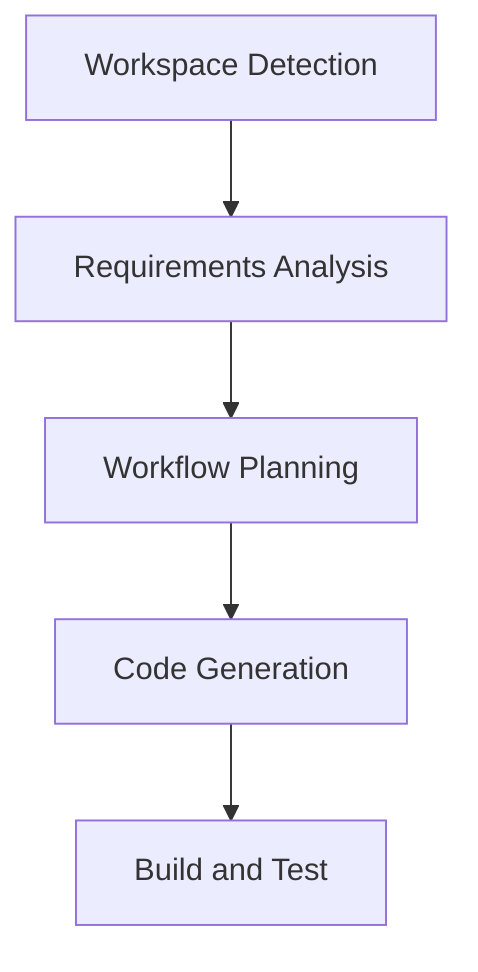

# Workflow Plan

## Recommended Phases

- Workspace Detection: Completed
- Requirements Analysis: Completed
- User Stories: Skipped (simple analysis task)
- Workflow Planning: Current
- Application Design: Skipped (no new components)
- Units Generation: Skipped (single unit: analysis)
- Functional Design: Minimal (simple analysis logic)
- NFR Requirements: Minimal (basic requirements)
- NFR Design: Skipped
- Infrastructure Design: Skipped
- Code Generation: Execute (generate compliance report)
- Build and Test: Execute (validate report)

## Workflow Visualization

## Rationale

The project is greenfield with a simple analysis request, so most inception phases are skipped for efficiency.